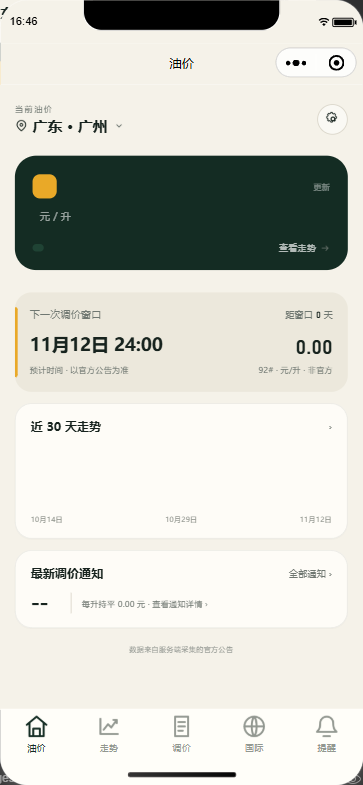
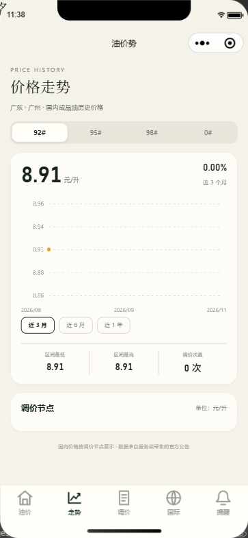
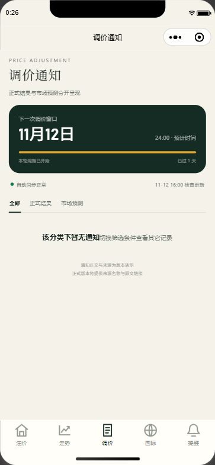
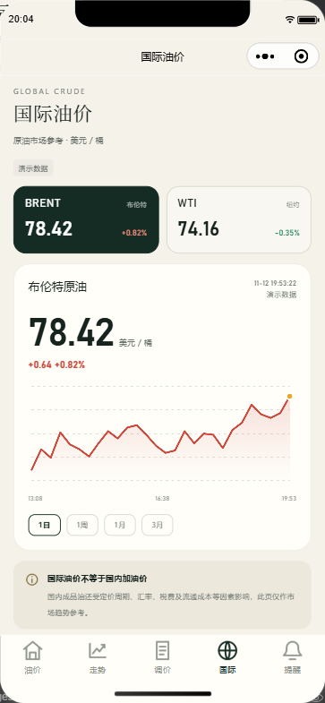
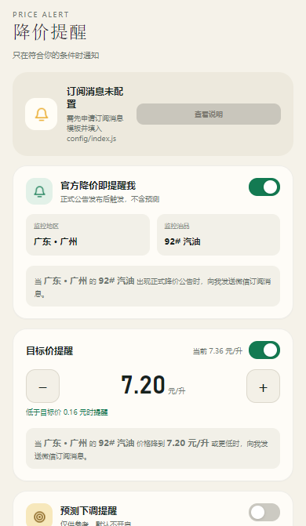

<a id="readme-top"></a>

<div align="center">
  
</div>

# 油势

<div align="center">

**查本地油价 · 等下一轮调价 · 设降价提醒**

原生微信小程序，五个一级页面。打开先看现在多少钱、下一轮涨还是跌，想设提醒再去提醒页。

</div>

<div align="center">

[![Version][version-shield]][version-url]
[![License][license-shield]][license-url]
[![Stars][stars-shield]][stars-url]
[![Forks][forks-shield]][forks-url]
[![Issues][issues-shield]][issues-url]
[![Backend][backend-shield]][backend-url]

</div>

<details>
<summary>目录</summary>

- [项目简介](#项目简介)
- [界面](#界面)
- [功能](#功能)
- [快速开始](#快速开始)
- [油价怎么算](#油价怎么算)
- [后端与接口](#后端与接口)
- [数据采集](#数据采集)
- [开发脚本](#开发脚本)
- [部署](#部署)
- [已知限制](#已知限制)
- [License](#license)
- [参考资料](#参考资料)

</details>

## 项目简介

油势是给车主用的油价小程序。打开就是本地 92# 的挂牌价、下一轮调价窗口和最近 30 天的走势，还能写一条「降到 7.5 就提醒我」的规则。

国内成品油价格有两条规矩决定了它的数据形态：调价幅度全国统一，落地零售价按地区定价。所以价格拆成两层算，地区价差按油品分开存，原因见[油价怎么算](#油价怎么算)。

后端不可用时，前端自动回落到本地演示源，界面会写明当前拿的是哪一种，不把演示数据说成实时行情。

## 界面

<div align="center">







<br />





</div>

<p align="center"><sub>截图由开发者工具自动化服务抓取，含 Canvas 图表图层，见 <a href="./docs/verification.md">验证记录</a>。</sub></p>

<p align="right">(<a href="#readme-top">back to top</a>)</p>

## 功能

- 首页把 92# 放在大卡，95#、98#、0# 按固定顺序排成小卡，不跟着点击顺序重排
- 切换大卡油品时，调价幅度、近 30 天走势、最新通知里的油品和金额一起换
- 走势图画阶梯线：横段是价格不变的调价周期，竖线是调价那一刻的跳变
- 调价页把正式公告和市场预测分成两栏，不只靠颜色区分，预测一律标「非官方」
- 国际页固定写明单位是美元/桶，行情延时多少分钟也照实标出来
- 提醒页可以写「官方降价就提醒我」，也能设目标价和单次降幅门槛，预测提醒默认关掉
- 采集解析不出结构化字段时进人工核对队列，不会把猜测值发布成正式结果

## 快速开始

### 需要什么

| 依赖 | 版本 | 用途 |
| --- | --- | --- |
| 微信开发者工具 | 2.02.2609250 或更新 | 编译与预览 |
| 基础库 | 3.8.10 | 运行时 |
| Node.js | 18 或更新 | 只给脚本和后端用，小程序本身没有构建步骤 |
| PostgreSQL | 15 或更新 | 后端数据库，可选 |

### 跑起来

```bash
git clone https://github.com/uwakeme/oil-trend.git
cd oil-trend
```

用微信开发者工具打开这个目录，直接编译。前端没有任何 npm 依赖，也不需要打包。

> [!IMPORTANT]
> `project.config.json` 里存的是占位 AppID `touristappid`。真实 AppID 写在本地的 `project.private.config.json`（不入版本控制），开发者工具会把它合并到工程配置上。

> [!WARNING]
> AppSecret 绝不能进代码或小程序包。这个项目的前端也不需要它，AppSecret 只放在服务器的 `server/.env` 里。

### 起后端（可选）

不配后端地址时，小程序走本地演示源，全部交互都能跑通。

```bash
cd server
npm install
cp .env.example .env
npm start
```

```js
// config/index.js
module.exports = {
  apiBaseUrl: 'https://你的域名',
  subscribeTemplateIds: ['你的模板ID'],
  dataSource: 'auto'
};
```

`apiBaseUrl` 留空就一律用演示数据。域名还得在公众平台的「服务器域名 → request 合法域名」里配好，否则请求会被直接拦掉，页面一直显示演示数据。

<p align="right">(<a href="#readme-top">back to top</a>)</p>

## 油价怎么算

调价幅度全国统一，落地零售价按地区定价，所以拆成两层：

```text
某地某油品价格 = 全国价（累加所有调价幅度）+ 地区价差（该地区、该油品）
```

地区价差必须按油品分别存。各省的标号结构并不一致，98# 相对 92# 的地区差从甘肃·兰州的 -0.68 到广东·广州的 +0.89，跨了 1.57 元/升；柴油相对 92# 的差额从海南·海口的 -0.96 到山西·太原的 +0.21。四个油品共用一套价差的话，98# 的误差最大能到 0.89 元/升。

数据真源在 `data/`：

| 文件 | 内容 |
| --- | --- |
| `data/adjustments.js` | 24 次调价节点的时间线 |
| `data/regions.js` | 31 个省级行政区的地区价差与采集页 slug |
| `data/reference-prices.js` | 各省真实挂牌价作校验基准，124 个值逐省比对 |

`server/src/shared/shared.js` 是 `scripts/sync-shared.js` 生成的产物，不是手写的。改完 `data/` 必须重跑同步脚本，它会断言生成物与 `data/` 逐项一致，手改生成文件，下次同步就给你盖回去。

演示数据集里，广东·广州 92# 是 8.91 元/升，最近一次调价在 2026-11-04 下调 0.08，近 3 个月有 6 个调价节点。

<p align="right">(<a href="#readme-top">back to top</a>)</p>

## 后端与接口

自建后端跑在 `server/`，Node 18 + Express + PostgreSQL，部署在 `https://oil-trend.uwakeme.top`。微信云开发那套已经下线，云函数目录也删了。

前端只认一条链路：

```text
页面 → utils/api.js → utils/cloud.js → 后端
```

取数只有 `utils/api.js` 一个入口，打交道的只有 `utils/cloud.js` 一个文件。换后端只改后者，页面和数据层一行不用动。

### 接口

查询类无需登录：

| 方法 | 路径 | 入参 | 返回 |
| --- | --- | --- | --- |
| GET | `/api/regions` | 无 | `{ regions }` |
| GET | `/api/home` | `regionCode` | `{ region, prices, window, trend30, changes, notice, publishedAt, source }` |
| GET | `/api/trend` | `regionCode, fuelId, period` | `{ region, fuel, price, deltaPercent, direction, axis, points, events, source }` |
| GET | `/api/notices` | `regionCode, filter, fuelId, skip` | `{ region, window, sync, notices, source }` |
| GET | `/api/market` | `symbol, period` | `{ symbol, price, changeAmount, changePercent, direction, open, prevClose, high, low, points, axis, delayed, quoteTime, source }` |
| GET | `/api/sync-status` | 无 | `{ status, sourceName, lastCheckedAt, needsReview, source }` |

用户类要带 `Authorization: Bearer <token>`：

| 方法 | 路径 | 说明 |
| --- | --- | --- |
| POST | `/api/login` | `wx.login()` 的 code 换 token |
| GET / POST | `/api/rules` | 读取与保存提醒规则 |
| GET / POST | `/api/history` | 读取与保存提醒历史 |

响应外壳统一：成功是 `{ ok: true, data }`，失败是 `{ ok: false, message, code }`。完整契约见 [自建后端方案](./docs/self-hosted-backend.md)。

<p align="right">(<a href="#readme-top">back to top</a>)</p>

## 数据采集

采集器每 30 分钟从**汽油价格网**抓 31 个省级行政区的挂牌价（92#、95#、98#、0#），6 小时新鲜期内不重复抓，31 省 3 并发。

两条硬约束一直守着：

1. 解析不出结构化字段就返回空，进人工核对队列，绝不把猜测值发布成正式结果
2. 预测类信息一律标非官方，来源只说方向没给幅度时，幅度留空而不是填 0

另外两个采集源（国家发改委调价公告、国际行情接口）配置已经写好，默认关闭，启用前要先单独验证可访问性、字段稳定性、更新频率和授权条款。

> [!NOTE]
> 各站 98# 的数据口径本身不统一，和 `data/reference-prices.js` 的个别省份对不上属于口径差异，不是解析 bug。回归测试只对北京、陕西、云南三省做逐值比对。

## 开发脚本

| 命令 | 作用 |
| --- | --- |
| `node scripts/lint-wxml.js` | 静态检查 WXML 绑定、事件、样式类与标签闭合，有错 exit 1 |
| `node scripts/check-modules.js` | 逐个 require 运行时模块与服务端模块，挡加载期 ReferenceError |
| `node scripts/verify-data.js` | 打印数据层算出的价格、走势、通知与行情 |
| `node scripts/verify-collector.js` | 采集器解析回归，`--live` 追加真实抓取与 pg-mem 入库 |
| `node scripts/sync-shared.js` | 由 `data/` 生成服务端共享模块并做一致性断言 |
| `node scripts/build-icons.js` | 重生成 `assets/icons/*.png`，需要本机 Chrome |
| `node scripts/preview-qr.js <appid>` | 上传预览包并出扫码图，必须用正式 AppID |
| `node scripts/verify-in-devtools.js` | 连开发者工具逐页截图并捕获运行时异常 |
| `cd server && npm test` | 后端自检：结构 51 项、HTTP 26 项、文档一致性 60 项，外加调度器与采集器回归 |

静态检查抓出过几个真 bug，比如 `wx:for` 里写成 `{{path}}`（应该是 `{{item.path}}`），以及 `<br>` 不是 WXML 内置标签导致整页编译失败。这类问题静态检查查得出来，渲染结果还得在模拟器里逐页核对。

跑截图脚本前要先装依赖并起自动化服务：

```bash
npm i --prefix .tooling ws
node scripts/verify-in-devtools.js
```

<p align="right">(<a href="#readme-top">back to top</a>)</p>

## 部署

后端走 GitHub Actions：`server/` 有改动推到 `main` 就自动部署，流水线会先跑一遍后端自检，不过不部署。服务器上用 pm2 托管进程，部署过程不碰 nginx，也不碰这台机器上的其他服务。

### 环境变量

真实值只写在服务器的 `server/.env` 里，不入库。

| 变量 | 说明 | 默认值 |
| --- | --- | --- |
| `DATABASE_URL` | PostgreSQL 连接串 | 必填 |
| `WX_APP_ID` | 小程序 AppID，与 `project.private.config.json` 同一个 | 必填 |
| `WX_APP_SECRET` | 小程序 AppSecret，只在服务器上 | 必填 |
| `OIL_TOKEN_SECRET` | 自签 token 的密钥，一串足够长的随机字符 | 必填 |
| `OIL_SUBSCRIBE_TEMPLATE_ID` | 订阅消息模板 ID | 可选 |
| `OIL_API_BASE_URL` | 后端对外地址，流水线用它做健康检查 | 无 |
| `PORT` | 服务端口 | `3000` |
| `OIL_COLLECT_CRON` | 采集频率，六段 cron | `0 */30 * * * *` |
| `OIL_ALERT_CRON` | 提醒频率，六段 cron | `0 */10 * * * *` |

完整步骤和排查表都在[部署指南](./docs/server-deploy.md)里。

<p align="right">(<a href="#readme-top">back to top</a>)</p>

## 已知限制

- 订阅消息还没走通到底，缺正式 AppID 与模板 ID。没配置时「提醒」页会明说未配置，不会假装授权成功
- 国家发改委公告与国际行情两个采集源还没启用，调价窗口的预测目前来自汽油价格网
- 页面 WXSS 里还有 42 处硬编码色值（26 处 hex + 16 处 rgba 阴影/边框）没走 `styles/tokens.wxss` 的设计令牌，纯样式一致性问题，不影响功能
- 小程序主包有 2MB 上限，`project.config.json` 的 `packOptions.ignore` 已经排除了 `docs`、`design`、`scripts`、`server` 这些非运行文件
- 换过 AppID 之后预览二维码要重出，预览包是按 AppID 上传的，旧码会指向已经不存在的账号

## License

MIT，见 [LICENSE](./LICENSE)。

## 参考资料

- [数据源接入说明](./docs/data-sources.md)：每个来源怎么解析、怎么验证
- [自建后端方案](./docs/self-hosted-backend.md)：接口契约与认证流程
- [部署指南](./docs/server-deploy.md)：建表、配置与验证清单
- [部署流水线](./docs/server-deploy-ci.md)：GitHub Actions 的每一步
- [验证记录](./docs/verification.md)：抓出来的真 bug 与踩过的坑
- [产品与页面设计](./design/product-design.md)：设计真源
- [汽油价格网](http://www.qiyoujiage.com/)：当前唯一启用的采集来源
- [aalavender/OilPrice](https://github.com/aalavender/OilPrice) 与 [vikiboss/60s](https://github.com/vikiboss/60s)：采集写法参考
- [微信订阅消息文档](https://developers.weixin.qq.com/miniprogram/dev/api/open-api/subscribe-message/wx.requestSubscribeMessage.html)

<!-- MARKDOWN LINKS & IMAGES -->
[version-shield]: https://img.shields.io/github/v/tag/uwakeme/oil-trend.svg?style=for-the-badge
[version-url]: https://github.com/uwakeme/oil-trend/tags
[license-shield]: https://img.shields.io/github/license/uwakeme/oil-trend.svg?style=for-the-badge
[license-url]: https://github.com/uwakeme/oil-trend/blob/main/LICENSE
[stars-shield]: https://img.shields.io/github/stars/uwakeme/oil-trend.svg?style=for-the-badge
[stars-url]: https://github.com/uwakeme/oil-trend/stargazers
[forks-shield]: https://img.shields.io/github/forks/uwakeme/oil-trend.svg?style=for-the-badge
[forks-url]: https://github.com/uwakeme/oil-trend/network/members
[issues-shield]: https://img.shields.io/github/issues/uwakeme/oil-trend.svg?style=for-the-badge
[issues-url]: https://github.com/uwakeme/oil-trend/issues
[backend-shield]: https://img.shields.io/badge/backend-online-brightgreen?style=for-the-badge
[backend-url]: https://oil-trend.uwakeme.top/health
